<picture><source media="(prefers-color-scheme: dark)" srcset="assets/banner-dark.svg"></picture>

<picture><source media="(prefers-color-scheme: dark)" srcset="assets/typing-dark.svg"></picture>

## About

A full-time CS student preparing for DevOps Engineering among other roles such as:

- Cloud Engineering
- Platform Engineering
- Systems Engineering
- DevSecOps Specialist
- Site Reliability Engineering (SRE) / Production Engineering

## Skills

<picture><source media="(prefers-color-scheme: dark)" srcset="assets/skills-dark.svg"></picture>

## Work

<a href="https://ardaneflashcards.store"><picture><source media="(prefers-color-scheme: dark)" srcset="assets/card-ardane-dark.svg"></picture></a>
<a href="https://shipyardcollective.dev"><picture><source media="(prefers-color-scheme: dark)" srcset="assets/card-shipyard-dark.svg"></picture></a>
<a href="https://github.com/NathanJeckoniah/njjeckoniah-builds"><picture><source media="(prefers-color-scheme: dark)" srcset="assets/card-builds-dark.svg"></picture></a>

## Contact

